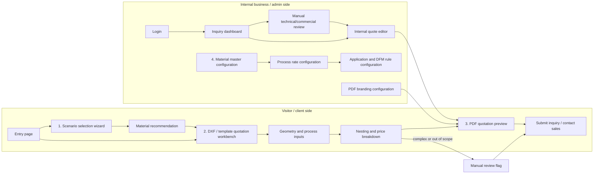
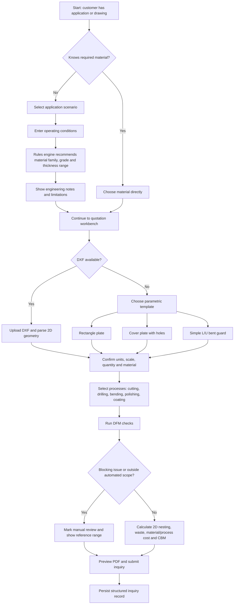
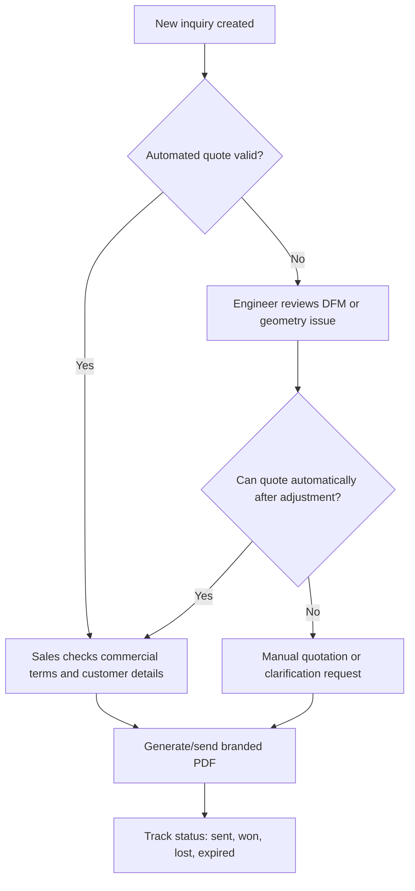

# B2B Engineering Plastics CPQ MVP — Information Architecture, User Flows, and PRD

## 1. Product objective

Build a Phase 1 B2B system for engineering plastic sheet and fabrication customers that lets a visitor, customer, or internal salesperson complete a technically structured selection and quotation workflow in about three minutes:

1. **Selection:** enter application and operating conditions; receive candidate material grade, thickness guidance, thermal-movement notes, and deflection or bending cautions.
2. **Quotation:** upload a 2D DXF or use a parametric template; derive cutting perimeter, holes, bends, polished edges, nesting sheet count, waste ratio, material cost, process cost, packaging/CBM estimate, and total price.
3. **Deliverables:** generate a branded PDF quotation and basic engineering selection note, then store the inquiry as structured data.

Phase 1 is deliberately narrow. It is a specification and quotation workflow, not an ERP, inventory system, payment system, 3D CAD platform, or multi-factory marketplace.

## 2. Users and roles

| Role | Goal | Permissions |
|---|---|---|
| Visitor / overseas customer | Get a technically credible budget quotation or submit a complete RFQ | Public wizard, DXF/template quoting, PDF preview, inquiry submission |
| Internal salesperson | Respond faster and consistently to incomplete inquiries | Create/edit quotes, review customer submissions, adjust commercial terms, resend PDF |
| Application engineer | Control technical rules and risky cases | Review flagged quotes, maintain DFM rules and material constraints |
| Admin | Maintain materials, sheet sizes, rates, branding, users and visibility | Configuration pages, publish/version rule changes |

## 3. Information architecture

## 4. Core user flows

### 4.1 Guided visitor flow

### 4.2 Internal sales review flow

## 5. Phase 1 scope

### In scope

Materials:

- solid polycarbonate sheet (PC solid / endurance sheet)
- multiwall polycarbonate sheet (PC multiwall / sunlight sheet)
- cast and extruded acrylic (PMMA)
- PETG sheet

Processes:

- CNC or laser cutting
- drilling
- simple bending
- polishing
- hard-coating / anti-fog coating as configurable surface operations

Quotation inputs:

- DXF upload for 2D geometry
- parametric templates: rectangular plate, cover plate with holes, simple L-shaped or U-shaped bent guard
- standard sheet sizes, initially 1220×2440 mm and 2050×3050 mm, extensible by configuration

Outputs:

- material recommendation and limitations
- material/process/packaging price breakdown
- nesting sheet count and waste ratio
- packaging volume / sea-freight CBM estimate
- branded PDF quotation and basic selection note
- structured inquiry record

### Out of scope for Phase 1

- 3D modelling or 3D CAD reconstruction
- ERP, inventory, production scheduling or warehouse management
- online payment
- multi-factory bidding or marketplace functionality
- certified structural engineering design
- automated approval of complex tooling, thermoforming or multi-operation assemblies
- customer-specific negotiated price books in the first iteration unless implemented as simple visibility rules

## 6. 80/20 automation policy

| Case type | System behaviour |
|---|---|
| Standard 2D geometry within configured sheet size | Automated exact list price using configured rates |
| Simple L/U bending within material thickness/radius rules | Automated price, with engineering warnings |
| Oversized part requiring joining or special packing | Mark manual review; show broad reference range only |
| Complex contour, dense holes, nested features or ambiguous DXF layers | Mark manual review; ask for confirmation |
| Unsupported material/process combination | Block automated exact price and request engineering review |
| Missing commercial terms, destination or quantity | Allow preview but mark inquiry incomplete |

## 7. Page-level PRD

### Page 1 — Scenario selection wizard

**Purpose:** convert application requirements into a candidate material family, grade, thickness range and technical caution set.

**Primary users:** visitor, customer, internal salesperson.

**Inputs:**

- application scenario: machine guarding, greenhouse, roofing/canopy, display, lighting/signage, splashback, sound barrier, energy-storage insulation, general fabricated part
- environment: indoor/outdoor, UV exposure, temperature range, chemical exposure, humidity/condensation
- performance requirements: impact resistance, flame retardancy, ESD, anti-fog, optical clarity, diffusion, colour, scratch resistance
- structural inputs where relevant: span, load, panel dimensions, support condition
- fabrication intent: flat cut part, drilled plate, bent guard, polished visible part

**Outputs:**

- recommended material family and grade route
- thickness range or starting thickness, clearly marked as guidance
- engineering notes: thermal expansion, bending radius, deflection/span limitations, UV/fire/impact cautions
- missing-information checklist
- continue-to-quote action with selections prefilled

**Acceptance criteria:**

- user can complete the wizard without knowing material terminology;
- every recommendation explains assumptions and uncertainty;
- unsupported claims are not displayed as certified values;
- result links to the quotation workbench rather than ending as static content.

### Page 2 — 2D drawing/template quotation workbench

**Purpose:** capture geometry, material, quantity and process operations, then calculate manufacturability, nesting and cost.

**Inputs:**

- material family, grade, thickness, colour/surface/functional coating
- DXF upload or parametric template selection
- dimensions, quantity, units and scale confirmation
- processes: cutting, drilling, bending, polishing, coating
- destination, delivery term and target lead time

**DXF extraction requirements:**

- outer contour length / cutting perimeter
- enclosed holes and hole count
- hole diameters where detectable
- bend lines if represented by configured layer naming or template parameters
- warnings for splines, text, duplicate entities, open contours, scale ambiguity or unsupported entities

**Outputs:**

- parsed geometry summary
- DFM warnings and manual-review flags
- nesting result: standard sheet size, sheet count, utilization/waste ratio
- cost breakdown: material, cutting, drilling, bending, polishing, coating, packaging, logistics reference/CBM, overhead/margin, total
- exact price or reference range depending on automation confidence

**Acceptance criteria:**

- user can switch between DXF and template without losing material selection;
- all calculations display inputs and formulas at a summary level;
- complex cases do not produce false exact pricing;
- output is stored as a structured quote item, not only as a visual screen.

### Page 3 — PDF quotation / calculation-note preview

**Purpose:** produce a customer-facing branded quotation and a concise engineering selection note.

**Inputs:**

- quote result from workbench or internal editor
- customer/company/contact details
- commercial terms: validity, Incoterm, destination, lead time, payment term text
- internal or customer-facing visibility mode

**Outputs:**

- branded PDF with logo, company details, customer details and quote number
- item table: material, dimensions, quantity, operations, unit price, total
- engineering selection note: recommended material rationale, thermal movement, bending/installation cautions, DFM warnings, limitations
- commercial terms and validity
- manual-review wording when exact automation is unavailable

**Acceptance criteria:**

- PDF preview matches final generated structure;
- manual-review cases are visually distinct from exact automated quotes;
- internal cost/margin details can be hidden from customer PDF;
- quote number and version are traceable to stored inquiry data.

### Page 4 — Admin material/process/rate configuration

**Purpose:** let authorized internal users maintain the data that drives selection, DFM checks, nesting and pricing without code changes.

**Configuration sections:**

- material families and grades
- sheet sizes and availability
- process operations and rate cards
- application rules and selection logic
- DFM rules and severity levels
- packaging assumptions and CBM factors
- PDF branding and terms templates

**Acceptance criteria:**

- rates/materials are versioned or at least audit-stamped;
- invalid rates or missing required fields cannot be published silently;
- every quote stores the configuration version used;
- admins can deactivate a material/process without deleting historical quote records.

## 8. MVP success metrics

- median time to create a complete internal quotation draft
- percentage of inquiries with all required technical fields captured
- percentage of standard rectangle/simple-hole quotes generated without manual calculation
- reduction in repeated follow-up questions per inquiry
- percentage of automated quotes later changed for engineering reasons
- quote-to-order conversion by application segment
- number of DFM issues caught before order confirmation

## 9. Prototype implementation status

The clickable structural prototype is available at [tools/cpq-prototype/index.html](../../../tools/cpq-prototype/index.html). It implements the four-step flow with parametric templates, a simulated-DXF demonstration mode, rectangle nesting, plastic-specific DFM findings, quotation breakdown, PDF-preview structure, local inquiry-record output and a placeholder admin-rate configuration panel. It intentionally uses demonstration rates and does not implement real DXF parsing, authentication, server persistence or production PDF generation.

## 10. Key dependencies and risks

- DXF parsing quality determines whether automated quoting is trusted.
- Nesting can begin with conservative rectangle packing but must not claim exact production yield until validated.
- Multiwall structural performance cannot be inferred from solid-sheet geometry; manufacturer-specific data is required.
- Material prices and process rates must be treated as configuration data with effective dates.
- Engineering outputs need clear limitations to avoid implying certified design approval.
