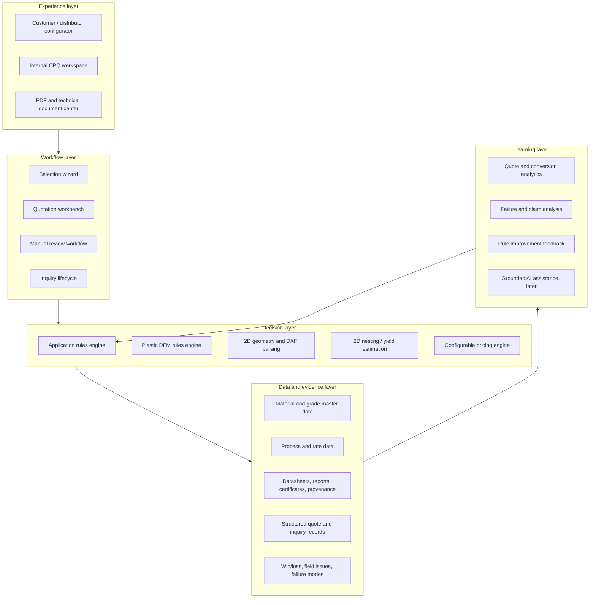

# Polymer Sheet Digital Business Platform Blueprint

## 1. North-star thesis

The larger opportunity is not merely to automate one quotation screen. It is to build the digital specification infrastructure for an engineering polymer sheet business: a platform that connects customer requirements, material evidence, engineering rules, fabrication constraints, quotation workflows, technical documents, quality traceability and field outcomes.

Traditional sheet suppliers compete with PDFs, spreadsheets, email threads and individual experience. A digital business platform can instead make specification faster, quotation more consistent, engineering risk more visible, and every project a source of structured learning.

The first implementation remains the focused [B2B CPQ MVP](b2b-cpq-mvp/information-architecture-and-prd.md). The broader blueprint below explains why that MVP is the entry point to a larger, defensible system rather than an isolated calculator.

## 2. Business workflows covered by the platform

The platform should eventually connect the complete commercial-technical chain, but without becoming an ERP. Manufacturing execution, inventory and payment stay outside the core scope.

## 3. User groups and jobs to be done

| User | Job to be done | Platform value |
|---|---|---|
| Overseas industrial buyer | Describe a use case and receive a credible technical quotation quickly | Less dependence on slow email iteration; clearer technical confidence |
| Design engineer / architect | Compare material routes and understand limitations | Traceable engineering assumptions and documentation |
| Distributor | Configure products for local customers without deep materials expertise | Faster response, fewer mistakes, stronger attachment to supplier platform |
| Internal salesperson | Convert incomplete inquiries into structured quotes | Less repetitive follow-up and manual calculation |
| Application engineer | Control rules, exceptions and technical risk | Engineering knowledge becomes reusable and auditable |
| QC / technical documentation owner | Connect grades, batches, evidence and customer documents | Better traceability and fewer unsupported claims |
| Management | Understand conversion, application demand, failure modes and quote efficiency | Data-driven product and sales decisions |

## 4. Layered platform architecture

## 5. Platform modules

### 5.1 Customer and distributor specification portal

Purpose: guide non-expert users through application, environment and performance requirements.

Long-term capabilities:

- application-driven material selection
- customer-facing product configuration
- multilingual technical explanations
- sample/evidence request workflow
- saved project configurations
- distributor-specific visibility or branding in later phases

This module should only be exposed externally after internal rules are validated.

### 5.2 Internal CPQ workspace

Purpose: help internal sales and engineering teams produce technically consistent quotes faster.

Core capabilities:

- structured inquiry intake
- material and thickness recommendation
- 2D template and DXF-based geometry capture
- process selection and DFM warnings
- nesting, waste, process-cost and packaging estimates
- manual review workflow for exceptions
- customer-facing and internal price views

### 5.3 Engineering rules and decision engines

This is the technical heart of the platform.

- deterministic application rules before AI
- material compatibility rules
- plastic-specific DFM checks
- thermal movement, bending, span and fabrication screening
- confidence and evidence status for every recommendation
- versioned rule changes and quote reproducibility

AI can later help retrieve evidence, summarize project requirements or draft customer responses, but it should be grounded in these validated rules rather than replacing them.

### 5.4 Geometry, nesting and fabrication intelligence

Long-term capabilities:

- real DXF entity parsing and contour reconstruction
- hole, bend-line and feature recognition
- geometry quality/confidence scoring
- true-shape nesting rather than bounding-box approximation
- fabrication time and complexity estimation
- template library for common guards, covers, panels and bent parts

This is one of the highest-value engineering software areas because it connects customer input directly to manufacturing cost drivers.

### 5.5 Evidence, quality and traceability layer

Purpose: make product claims verifiable and reduce technical/commercial risk.

Capabilities:

- datasheet and certificate repository
- provenance tracking for every material property
- batch or production-run document association
- customer-facing technical package generation
- quality-control evidence linked to grades and orders
- warranty/installation requirement traceability

This module can become a differentiator in export markets where buyers increasingly expect reliable documentation.

### 5.6 Structured inquiry intelligence

Every quote should become reusable data.

Track:

- application segment and geography
- requested dimensions, thicknesses and features
- material recommendations and final customer choices
- manual-review reasons
- won/lost/expired status and loss reasons
- customer modifications before order
- claims, installation issues and failure modes

This creates a proprietary dataset connecting engineering requirements to commercial and field outcomes.

### 5.7 Document generation and technical communication

Capabilities:

- branded PDF quotations
- engineering selection notes
- installation and fabrication guides generated from controlled data
- datasheet packages by grade/thickness/application
- multilingual versions where justified
- document versioning and quote-specific snapshots

### 5.8 API and ecosystem layer

Later-stage possibilities:

- distributor API for product configuration and quote creation
- customer ERP/procurement integration without turning this product into an ERP
- embeddable selectors for partner websites
- webhook/export of structured inquiry data
- controlled API access to evidence and documentation

## 6. Scope boundaries

The platform can be large without absorbing every adjacent system.

### In long-term scope

- specification, selection and quotation workflows
- engineering rules, DFM and geometry intelligence
- evidence and technical documentation
- inquiry analytics and learning
- distributor/customer configuration interfaces
- API access to controlled platform capabilities

### Out of scope

- full ERP, accounting or warehouse management
- production scheduling and MES
- online payment or commodity marketplace
- generic 3D CAD modelling
- multi-factory auction/bidding network
- unsupported certified engineering approval

## 7. Phased roadmap

### Phase 0 — 3-day structural framework

Goal: prove that the architecture is coherent and visible enough for real users and application reviewers.

Deliverables:

- information architecture and PRD
- data/rules/pricing/DFM design
- clickable structural prototype
- demonstration configuration using placeholder rates
- honest documentation of what is prototype versus production capability

### Phase 1 — internal CPQ MVP foundation

Goal: support internal sales/technical teams with structured selection and quotation drafts.

Major engineering work:

- material, grade, process, rate and rule schemas
- deterministic selection and DFM engines
- parametric geometry templates
- conservative nesting and cost calculations
- inquiry persistence model
- initial PDF rendering

### Phase 2 — geometry and document automation

Goal: handle real customer inputs rather than only clean demonstration cases.

Major engineering work:

- real DXF parser and geometry confidence scoring
- hole/bend/feature extraction
- improved nesting and waste estimation
- customer-facing PDF generation
- versioned technical document templates
- audit trail for manual adjustments

### Phase 3 — pilot and learning loop

Goal: validate business value with real inquiries.

Major engineering work:

- internal user pilot instrumentation
- quote status and outcome tracking
- manual-review reason taxonomy
- engineering-change analysis
- performance dashboards for quote time, completeness and conversion

### Phase 4 — distributor/customer portal

Goal: expose reliable parts of the system externally.

Major engineering work:

- account and permission model
- multilingual customer journey
- customer-safe explanations and document visibility
- distributor configuration profiles
- controlled external quote submission

### Phase 5 — evidence and ecosystem platform

Goal: build defensibility beyond quotation efficiency.

Major engineering work:

- batch/evidence linking
- customer-accessible document packages
- field-issue feedback loop
- API layer
- grounded AI assistance using validated internal data

## 8. Why this framework credibly requires substantial software engineering

This is not a single static webpage. A serious implementation includes multiple interacting engineering systems:

| Workstream | Examples of real engineering work |
|---|---|
| Data platform | schemas, migrations, validation, provenance, versioning, fixtures |
| Rules engine | deterministic rule evaluation, evidence status, conflict handling, unit tests |
| Geometry engine | DXF parsing, contour reconstruction, entity normalization, feature extraction |
| Nesting engine | rectangle packing first, true-shape nesting later, yield validation, orientation constraints |
| Pricing engine | configurable rates, effective dates, multipliers, quote reproducibility, currency handling |
| PDF/documents | templates, branding, localization, customer/internal visibility, snapshotting |
| Web application | wizard, workbench, review dashboard, admin configuration, permissions |
| Quality engineering | golden-quote tests, geometry fixtures, browser tests, CI, regression suites |
| Analytics | structured inquiry events, conversion tracking, manual-review analysis |
| AI grounding | retrieval over approved evidence only after data quality is reliable |

Devin is useful because much of this is parallelizable, testable software work: data models, parsers, validation, rule engines, UI implementation, document generation, fixtures and regression tests.

## 9. Strategic value and defensibility

### Efficiency value

- fewer incomplete inquiries
- faster quotation turnaround
- less repeated manual engineering calculation
- fewer spreadsheet/PDF inconsistencies

### Risk-reduction value

- missing technical inputs become visible
- unsupported claims are reduced
- DFM risks are caught earlier
- quote assumptions and evidence are reproducible

### Commercial value

- faster response can improve conversion
- consistent technical documentation supports export credibility
- distributors gain a reason to use the supplier's platform rather than treating sheets as interchangeable commodities

### Data-moat value

Over time, the system accumulates proprietary relationships between:

- applications and required performance
- material grades and real project constraints
- fabrication geometry and cost drivers
- quotations and win/loss outcomes
- installation conditions and field issues

That learning loop is the long-term defensible asset.

## 10. Key risks and controls

| Risk | Control |
|---|---|
| False precision in automated pricing | confidence levels, manual-review states, clear formula assumptions |
| Engineering liability | conservative screening language, evidence status, no certified-design claims |
| Poor DXF quality | geometry confidence scoring, manual review, real-world fixture library |
| Bad material data | provenance fields, validation, effective dates, engineering approval workflow |
| Scope creep into ERP | strict boundaries and phased delivery |
| AI hallucination | deterministic rules first; AI only grounded in approved evidence |
| Commercial data exposure | role-based visibility and separation of internal margin from customer output |

## 11. MVP decision: large vision, narrow first proof

The platform vision should be large enough to matter, but the first proof must remain narrow:

- prove the data model and rule architecture;
- prove the customer workflow from selection to quotation preview;
- prove that DFM and pricing logic are configurable;
- prove that the output is useful to a real salesperson or customer;
- then invest in fuller DXF fidelity, contour reconstruction, persistence and production infrastructure.

That combination — large long-term platform, narrow verifiable first slice — is more credible than either a small calculator or an unrealistic promise to digitize the entire company at once.
